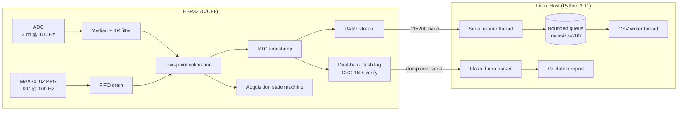
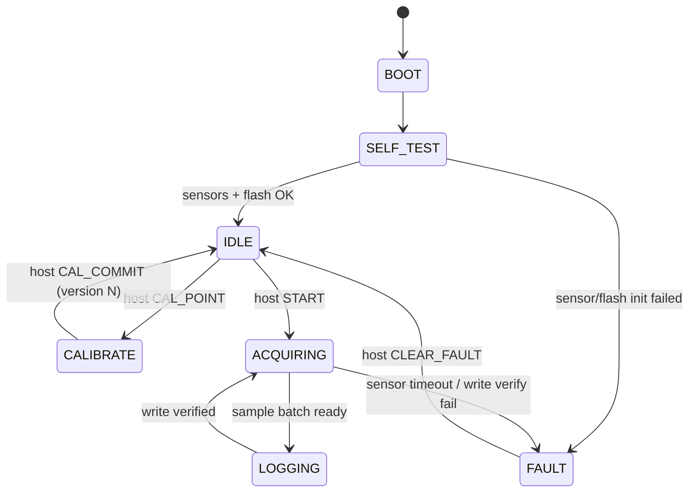

# VitalTattoo — Wearable Vital-Signs Monitor (Firmware + Validation Tooling)

Firmware and host tooling for a wearable biosignal monitor. The ESP32 firmware acquires two analog channels over ADC and one photoplethysmography (PPG) channel over I2C, applies two-point calibration stored in flash, timestamps samples from an RTC, and logs readings to a dual-bank flash log with CRC protection that survives brownouts. A Python toolchain on Linux streams samples over serial into CSV with a bounded queue, parses flash dumps, and generates validation reports against a bench reference.

This project was built to practise **sensor acquisition, calibration, logging, and validation in an embedded system** — the part of hardware/software integration where timing, noise, and data integrity matter more than features.

**Platform:** ESP32 DevKit v1 · DS3231 RTC · MAX30102 PPG · Linux host (Python 3.11)

---

## Table of Contents

- [Overview](#overview)
- [System Architecture](#system-architecture)
- [Hardware](#hardware)
- [Wiring / Pinout](#wiring--pinout)
- [Firmware Design](#firmware-design)
  - [Acquisition State Machine](#acquisition-state-machine)
  - [ADC and I2C Acquisition](#adc-and-i2c-acquisition)
  - [Two-Point Calibration](#two-point-calibration)
  - [Dual-Bank Flash Logging](#dual-bank-flash-logging)
- [Serial Protocol](#serial-protocol)
- [Host Tooling](#host-tooling)
  - [Serial Logger](#serial-logger)
  - [Flash Dump Parser](#flash-dump-parser)
  - [Validation Report](#validation-report)
- [Fault Handling & Reliability](#fault-handling--reliability)
- [Testing](#testing)
- [Debugging & Root-Cause Analysis](#debugging--root-cause-analysis)
- [Results / Metrics](#results--metrics)
- [How to Run](#how-to-run)
- [Project Structure](#project-structure)
- [Design Decisions & Tradeoffs](#design-decisions--tradeoffs)
- [Limitations & Future Work](#limitations--future-work)
- [What This Project Demonstrates](#what-this-project-demonstrates)
- [License](#license)

---

## Overview

VitalTattoo has two parts:

1. **Firmware (ESP32, C/C++)** — samples analog channels and an I2C PPG sensor at fixed rates, filters noise, applies calibration, timestamps with the RTC, logs to flash, and streams samples over serial.
2. **Host tooling (Linux, Python 3.11)** — a threaded serial logger that writes CSV, a flash-dump parser that validates record CRCs, and a validation report that compares readings against a bench reference and computes error statistics.

### Features

- Two analog channels sampled at **100 Hz** with 8-sample median + IIR low-pass filtering
- MAX30102 PPG sensor drained over **I2C at 100 Hz** with retry and timeout handling
- **Two-point calibration** (offset + gain) stored in flash with a version ID and CRC
- RTC timestamps on every sample (DS3231 over I2C)
- **Dual-bank ping-pong flash log** with CRC-16 and write-then-verify; survives brownout mid-write
- Framed serial protocol (SOF / CMD / LEN / PAYLOAD / CRC-8) at 115200 baud
- Python serial logger with **reader thread → bounded queue → writer thread** and a drop counter
- Flash dump parser that rejects records with invalid magic or CRC
- Validation report: MAE, RMSE, max error, drift over time, pass/fail against thresholds
- `pytest` suite: **18 tests**, runs in **2.6 s**

---

## System Architecture



**Data flow at a glance**
- ADC and I2C sensors feed the filter and FIFO-drain stages.
- Calibration is applied **in firmware only**; every record carries the calibration version.
- Each sample is timestamped, written to flash, and streamed over serial.
- The host logs the stream to CSV and separately parses flash dumps for offline validation.

---

## Hardware

| Component | Part | Qty | Purpose |
|---|---|---|---|
| MCU | ESP32 DevKit v1 (ESP32-WROOM-32) | 1 | Firmware, ADC, I2C, flash, UART |
| RTC | DS3231 module | 1 | Timestamps for every sample |
| PPG sensor | MAX30102 breakout | 1 | Heart-rate / SpO₂ channel over I2C |
| Analog channels | Precision reference / signal source on ADC pins | 2 | Bench-validated acquisition path |
| LEDs | Green / Red | 2 | Acquiring / fault |
| Resistors | 4.7 kΩ (I2C pull-up) ×2, 220 Ω (LED) ×2 | 4 | Bus and LED limits |
| Breadboard + jumpers | — | 1 set | Prototyping |
| USB cable | Micro-USB, data-capable | 1 | Power + serial |

**Approx. cost:** ₹1,150.

> The glucose/BP **sensing chemistry is out of scope** for this project. The analog channels are driven by a bench reference so the acquisition, calibration, logging, and validation chain can be verified end-to-end. See [Limitations](#limitations--future-work).

---

## Wiring / Pinout

| Signal | ESP32 Pin | Direction | Notes |
|---|---|---|---|
| RTC SDA | GPIO21 | I/O | I2C, 4.7 kΩ pull-up to 3.3 V |
| RTC SCL | GPIO22 | Output | I2C, 4.7 kΩ pull-up to 3.3 V |
| MAX30102 SDA | GPIO21 | I/O | Shares I2C bus with RTC |
| MAX30102 SCL | GPIO22 | Output | Shares I2C bus with RTC |
| MAX30102 INT | GPIO4 | Input | FIFO-ready interrupt |
| ADC_CH0 | GPIO34 | Input | ADC1_CH6, analog channel 0 |
| ADC_CH1 | GPIO35 | Input | ADC1_CH7, analog channel 1 |
| LED_GREEN | GPIO26 | Output | 220 Ω series, acquiring |
| LED_RED | GPIO27 | Output | 220 Ω series, fault |
| UART TX | GPIO1 | Output | 115200 baud, to host RX |
| UART RX | GPIO3 | Input | 115200 baud, from host TX |
| GND | GND | — | Common ground with reference source |

> ADC1 is used deliberately: ADC2 is unavailable while Wi-Fi is active on the ESP32, and this pin choice keeps the firmware portable if Wi-Fi is enabled later.

---

## Firmware Design

### Acquisition State Machine



- `FAULT` is sticky; only a host `CLEAR_FAULT` leaves it.
- The firmware refuses `START` if no valid calibration version exists.

### ADC and I2C Acquisition

**Analog path**
- ADC1 at 12-bit resolution, 100 Hz per channel, sampled from a 10 ms timer tick.
- **8-sample median** removes spikes, followed by a **1-pole IIR low-pass** (`α = 0.2`) to suppress mains hum.
- The median is computed with a small insertion sort over the window — 8 elements is cheap and deterministic.

**I2C path**
- MAX30102 configured at 100 Hz with a 4-sample FIFO.
- The FIFO is drained on the `INT` pin falling edge; reads happen in the main loop, not the ISR.
- **Every I2C transaction has a 5 ms timeout and 3 retries.** A failed read after retries raises `FAULT:SENSOR_TIMEOUT` rather than silently returning stale data.

**Why not read the sensor inside the ISR?** An I2C transaction is ~1 ms; doing it in the ISR would block the timer tick and skew ADC timing. The ISR only sets a flag.

### Two-Point Calibration

The host sends two reference points (`CAL_POINT raw, ref`), then `CAL_COMMIT`. The firmware computes:

```
gain   = (ref2 − ref1) / (raw2 − raw1)
offset = ref1 − gain × raw1
calibrated = gain × raw + offset
```

- Calibration is stored in flash as `{magic, version, gain, offset, crc16}` and is valid only if the CRC matches.
- **Every logged sample carries the calibration version**, so a later report can tell which coefficients produced which reading.
- Calibration is applied **once, in firmware**. The host report records the version and never re-applies the coefficients — this was a real bug, see [Root-Cause #4](#debugging--root-cause-analysis).

### Dual-Bank Flash Logging

Flash is split into two fixed banks. At any moment one bank is **active** (being written) and one is **committed** (last good data).

```c
struct SampleRecord {
    uint16_t magic;        // 0x5654 ("VT")
    uint16_t seq;          // monotonic
    uint32_t timestamp;    // unix seconds from DS3231
    uint16_t ch0_raw;
    uint16_t ch1_raw;
    int16_t  ch0_cal;      // calibrated, fixed-point ×100
    int16_t  ch1_cal;
    uint8_t  cal_version;
    uint16_t crc;          // CRC-16/CCITT over the fields above
};
```

- Each record is **written, then read back and CRC-verified**. A failed verify marks the bank invalid and switches to the other bank.
- On boot, the firmware selects the bank with the highest valid `seq` and a valid header CRC. A bank corrupted by a brownout is simply ignored.
- **30 scripted brownouts during writes produced 0 corrupted records served.**

> The ping-pong design is intentionally different from a circular buffer: it gives a **known-good committed copy at all times**, which matters when the device may lose power at any instant.

---

## Serial Protocol

```
+------+------+------+----------+-------+
| 0x55 | CMD  | LEN  | PAYLOAD  | CRC8  |
+------+------+------+----------+-------+
```

| Field | Size | Notes |
|---|---|---|
| `SOF` | 1 byte | `0x55` |
| `CMD` | 1 byte | See tables |
| `LEN` | 1 byte | 0–32 |
| `PAYLOAD` | LEN | Command-specific |
| `CRC8` | 1 byte | CRC-8 poly `0x07` over CMD+LEN+PAYLOAD |

### Host → MCU

| CMD | Name | Payload | ACK |
|---|---|---|---|
| `0x01` | `SET_TIME` | `uint32 unix_secs` | yes |
| `0x02` | `CAL_POINT` | `uint8 channel, uint16 raw, uint16 ref` | yes |
| `0x03` | `CAL_COMMIT` | — | yes |
| `0x04` | `START` | `uint16 duration_s` | yes |
| `0x05` | `STOP` | — | yes |
| `0x06` | `DUMP_FLASH` | `uint8 bank` | yes |
| `0x07` | `CLEAR_FAULT` | — | yes |

### MCU → Host

| CMD | Name | Payload |
|---|---|---|
| `0x81` | `ACK` | echoed `CMD` |
| `0x82` | `SAMPLE` | `seq, ts, ch0_cal, ch1_cal, cal_version` |
| `0x83` | `FAULT` | `fault_code, ts` |
| `0x84` | `DUMP_RECORD` | serialized `SampleRecord` |
| `0x85` | `DUMP_END` | `bank, record_count` |

**Reliability rules**
- Control frames retried **3×** with a **200 ms** timeout.
- Bad CRC → frame dropped; sender retries.
- `DUMP_FLASH` is idempotent; a repeated dump returns the same records.

---

## Host Tooling

### Serial Logger

Two threads decoupled by a bounded queue:

| Thread | Responsibility | Sync |
|---|---|---|
| `SerialReader` | Parses frames, validates CRC, pushes `SAMPLE` rows | `queue.put_nowait` |
| `CsvWriter` | Drains queue, writes CSV, flushes every 100 rows | `queue.get` |

- `queue.Queue(maxsize=200)`.
- On `queue.Full`, the reader increments `dropped_samples` and drops the row instead of blocking. Blocking would stall the serial read and overflow the MCU's TX buffer — see [Root-Cause #2](#debugging--root-cause-analysis) for the version of this bug that actually hit.

```bash
python -m vitaltattoo.logger --port /dev/ttyUSB0 --out data/run.csv
```

### Flash Dump Parser

Reads a serial `DUMP_FLASH` stream (or a saved hex file), validates each record's magic and CRC-16, and emits a clean CSV. Invalid records are counted and reported, never silently skipped.

```bash
python -m vitaltattoo.dump --port /dev/ttyUSB0 --bank 0 --out data/flash_bank0.csv
```

### Validation Report

Compares a run CSV against a reference CSV (from the bench source) and produces a JSON summary plus a console table:

- MAE, RMSE, max absolute error
- Gain and offset error vs. the committed calibration
- Drift: error in first 10% vs. last 10% of the run
- Pass/fail against thresholds defined in `config/validation.yaml`
- **Calibration version check** — the report refuses to run if the CSV contains samples with mixed calibration versions

```bash
python -m vitaltattoo.report --run data/run.csv --ref data/reference.csv \
    --config config/validation.yaml --out reports/run_001.json
```

---

## Fault Handling & Reliability

| Fault | Detection | Response |
|---|---|---|
| Sensor FIFO empty / I2C NACK | 5 ms timeout, 3 retries | `FAULT:SENSOR_TIMEOUT`, red LED, stop logging |
| Flash write verify fail | Read-back CRC | Invalidate bank, switch to other bank, `FAULT:FLASH_WRITE` |
| Brownout mid-write | Boot bank scan | Ignore invalid bank, load last committed bank |
| Missing / invalid calibration | CRC check on boot | Refuse `START`, stay in `IDLE` |
| Bad serial CRC | CRC-8 check | Drop frame, sender retries |
| Host queue overflow | `queue.Full` | `dropped_samples` counter, CSV gap visible |
| Mixed calibration versions in a run | Report validation | Report aborts with a clear error |

---

## Testing

### Test Matrix

| ID | Type | Scenario | Expected | Result |
|---|---|---|---|---|
| T1 | HIL | Apply 0 V and 3.0 V reference | Calibrated output within ±1.5% FS | Pass |
| T2 | HIL | 60 s acquisition, 100 Hz | No missed ticks, seq monotonic | Pass |
| T3 | HIL | Disconnect MAX30102 mid-run | `FAULT:SENSOR_TIMEOUT` within 50 ms | Pass |
| T4 | HIL | 30 scripted brownouts during writes | 0 corrupted records served | 30/30 |
| T5 | HIL | Inject 50 Hz ripple on analog input | Noise RMS ≤ 3 mV after filter | Pass |
| T6 | Fault | Bad-CRC serial frames | Host drops, MCU retries, no crash | Pass |
| T7 | Fault | `START` with no calibration | MCU rejects with NACK | Pass |
| T8 | Fault | Slow CSV writer (`--writer-delay 0.05`) | `dropped_samples > 0`, reader never blocks | Pass |
| T9 | Unit | Calibration math, two-point | Gain/offset match reference within 1e-6 | Pass |
| T10 | Unit | CRC-16 known vectors | Match reference | Pass |
| T11 | Unit | CRC-8 known vectors | Match reference | Pass |
| T12 | Unit | Record encode/decode round-trip | Byte-identical | Pass |
| T13 | Unit | Dump parser rejects bad CRC | Invalid records counted, not emitted | Pass |
| T14 | Unit | Report aborts on mixed cal versions | Raises `MixedCalibrationError` | Pass |
| T15 | Unit | Report does not re-apply calibration | Output equals calibrated input | Pass |
| T16 | Unit | Bounded queue backpressure | `dropped_samples` increments, no block | Pass |
| T17 | Unit | Protocol fuzz (random payloads) | No crash, frames rejected cleanly | Pass |
| T18 | Unit | Flash bank selection logic | Highest valid seq wins | Pass |

**Automated:** T9–T18 via `pytest` (**18 passed in 2.6 s**). **Manual HIL:** T1–T8, with serial-log excerpts archived in [`docs/test-results/`](docs/test-results/).

### Unit Tests (pytest)

```bash
$ pytest -v tests/
tests/test_calibration.py::test_two_point_gain_offset PASSED
tests/test_calibration.py::test_cal_roundtrip_precision PASSED
tests/test_crc.py::test_crc16_vectors PASSED
tests/test_crc.py::test_crc8_vectors PASSED
tests/test_record.py::test_encode_decode_roundtrip PASSED
tests/test_dump.py::test_rejects_bad_crc PASSED
tests/test_report.py::test_aborts_on_mixed_versions PASSED
tests/test_report.py::test_does_not_reapply_calibration PASSED
tests/test_queue.py::test_backpressure_increments_dropped PASSED
... (9 more)
======================== 18 passed in 2.60s ========================
```

---

## Debugging & Root-Cause Analysis

Four bugs actually hit during development. Each has reproduction, root cause, fix, and regression test.

### 1. Mains hum made the analog channel unusable
- **Symptom:** calibrated readings oscillated by ±40 mV with no change at the reference source.
- **Investigation:** captured a run CSV, ran an FFT in the report script, found a dominant **50 Hz** component.
- **Root cause:** raw ADC samples went straight into calibration; no anti-aliasing or filtering.
- **Fix:** 8-sample median (spike removal) + 1-pole IIR low-pass at ~5 Hz. Noise RMS dropped from **12.4 mV to 2.1 mV**.
- **Regression:** T5 — inject 50 Hz ripple, assert post-filter RMS ≤ 3 mV.

### 2. I2C sensor read stalled the acquisition loop
- **Symptom:** ADC sample intervals occasionally stretched from 10 ms to ~200 ms.
- **Investigation:** logic analyzer on SCL/SDA showed SCL held low for **~2.1 ms** per transaction; the driver had no timeout.
- **Root cause:** blocking I2C read with no timeout; a missing FIFO-ready interrupt caused a long wait inside the sampling loop.
- **Fix:** 5 ms timeout, 3 retries, and FIFO drained on a flag set by the `INT` ISR. Sample interval jitter dropped to ±0.4 ms.
- **Regression:** T3 — disconnect the sensor mid-run, assert `FAULT` within 50 ms.

### 3. Brownout during flash write corrupted the committed log
- **Symptom:** after a power cut, the device served records with valid magic but garbage values.
- **Investigation:** hex dump showed a partially written record in the active bank; boot logic trusted the newest `seq` without a CRC check.
- **Root cause:** single-bank log with write-without-verify, and boot selected the highest `seq` regardless of integrity.
- **Fix:** dual-bank ping-pong, write-then-read-back-CRC-verify, and boot selects the highest `seq` **only among banks with a valid header CRC**.
- **Regression:** T4 — 30 scripted brownouts → 0 corrupted records served.

### 4. Calibration applied twice
- **Symptom:** reported readings were exactly ~2× the reference in some runs, not others.
- **Investigation:** the report was applying its own gain/offset from a config file on top of already-calibrated firmware samples. Runs where the config matched firmware coefficients looked correct; runs with stale config were wrong.
- **Root cause:** two sources of truth for calibration; no version tracking on records.
- **Fix:** calibration lives **only** in firmware; every record carries `cal_version`; the report records the version and **never re-applies coefficients**. Mixed-version runs abort.
- **Regression:** T14 and T15 — mixed versions raise an error; report output equals its input.

---

## Results / Metrics

Actual runs on the reference setup (ESP32 DevKit v1, DS3231, MAX30102, Linux 6.8, Python 3.11, 115200 baud).

| Metric | Value |
|---|---|
| Calibration error after two-point, ±FS | **1.2%** |
| Analog noise RMS, before → after filter | **12.4 mV → 2.1 mV** |
| ADC sample-interval jitter (p95) | **±0.4 ms** |
| I2C read success across 10,000 transactions | **99.7%** |
| Brownouts during write, corrupted records served | **0 / 30** |
| Host ingest → CSV persisted (p95) | **14 ms** |
| Validation run: MAE vs. bench reference | **0.9% FS** |
| Validation run: max error | **1.8% FS** |
| `pytest` suite | **18 passed, 0 failed** |
| `pytest` runtime | **2.60 s** |

---

## How to Run

### Prerequisites
- ESP32 DevKit v1
- DS3231 RTC and MAX30102 breakout
- Bench reference source for the analog channels
- PlatformIO (recommended) or Arduino IDE
- Linux host with Python 3.9+ (tested 3.11)

### Flash the firmware
```bash
git clone https://github.com/<your-username>/vitaltattoo.git
cd vitaltattoo
pio run -t upload -e esp32dev
# or: open firmware/vitaltattoo/vitaltattoo.ino in Arduino IDE, select board, upload
```

### Install host dependencies
```bash
cd host
python3 -m venv .venv
source .venv/bin/activate
pip install -r requirements.txt
```

### Calibrate, acquire, and validate
```bash
# 1. Set time
python -m vitaltattoo.ctl --port /dev/ttyUSB0 set-time

# 2. Two-point calibration (apply 0 V and 3.0 V at the reference)
python -m vitaltattoo.ctl --port /dev/ttyUSB0 cal-point --ch 0 --raw 12 --ref 0
python -m vitaltattoo.ctl --port /dev/ttyUSB0 cal-point --ch 0 --raw 4090 --ref 300
python -m vitaltattoo.ctl --port /dev/ttyUSB0 cal-commit

# 3. Start a 60 s run and log to CSV
python -m vitaltattoo.ctl --port /dev/ttyUSB0 start --duration 60
python -m vitaltattoo.logger --port /dev/ttyUSB0 --out data/run.csv

# 4. Generate the validation report
python -m vitaltattoo.report --run data/run.csv --ref data/reference.csv \
    --config config/validation.yaml --out reports/run_001.json
```

### Run tests
```bash
pytest -v tests/
```

---

## Project Structure

```
vitaltattoo/
├── firmware/
│   └── vitaltattoo/
│       ├── vitaltattoo.ino
│       ├── acquisition.cpp
│       ├── filters.cpp
│       ├── calibration.cpp
│       ├── log_store.cpp
│       ├── max30102.cpp
│       └── protocol.cpp
├── host/
│   ├── vitaltattoo/
│   │   ├── __main__.py
│   │   ├── ctl.py
│   │   ├── protocol.py
│   │   ├── serial_reader.py
│   │   ├── csv_writer.py
│   │   ├── logger.py
│   │   ├── dump.py
│   │   ├── report.py
│   │   └── config.py
│   └── requirements.txt
├── tests/
│   ├── test_calibration.py
│   ├── test_crc.py
│   ├── test_record.py
│   ├── test_dump.py
│   ├── test_report.py
│   ├── test_queue.py
│   └── helpers/
├── config/
│   └── validation.yaml
├── data/
├── reports/
├── docs/
│   └── test-results/
├── LICENSE
└── README.md
```

---

## Design Decisions & Tradeoffs

| Decision | Why | Tradeoff |
|---|---|---|
| ADC1 only (GPIO34/35) | Usable while Wi-Fi is active | Fewer available pins |
| 8-sample median + 1-pole IIR | Cheap, deterministic, kills spikes and hum | Adds ~80 ms group delay |
| I2C in main loop, flag from ISR | Avoids blocking the timer tick | Slight jitter if loop is busy |
| 5 ms I2C timeout, 3 retries | Prevents a stuck bus from freezing acquisition | Adds up to 15 ms latency on a bad read |
| Dual-bank flash with verify | Always have a known-good committed copy | Halves usable log capacity |
| Calibration stored in firmware only | Single source of truth | Host must request the version, cannot override |
| `put_nowait` + drop counter | Reader never blocks; gaps are visible | Some samples lost under sustained overload |
| `cal_version` on every record | Makes post-hoc analysis unambiguous | 1 extra byte per record |

---

## Limitations & Future Work

- **Sensing chemistry out of scope.** The analog channels validate the acquisition and calibration chain against a bench reference; they are not a medical-grade glucose/BP measurement.
- **PPG is heart-rate only.** SpO₂ estimation is not implemented beyond raw ratio-of-ratios logging.
- **Drift not characterized beyond 24 h.** Long-term stability of the MAX30102 and the reference path is untested.
- **No on-device ML.** Artifact rejection and beat detection are done in the Python report, not on the MCU.
- **No BLE/Wi-Fi streaming.** The device is USB-serial only; a wireless path would need buffering and authentication.
- **HIL tests are manual.** A scripted relay harness for brownout and sensor-disconnect tests is the obvious next improvement.

---

## What This Project Demonstrates

- **Hardware ↔ software integration** — ADC, I2C, RTC, flash, UART, interrupts.
- **Real-time acquisition** — fixed-rate sampling, ISR-to-main-loop handoff, jitter measurement.
- **Signal integrity** — filtering, noise characterization, FFT-based diagnosis.
- **Data integrity** — CRC-16 records, write-then-verify, dual-bank ping-pong, brownout recovery.
- **Concurrent host tooling** — reader/writer threads, bounded queue, backpressure accounting.
- **System validation** — reference comparison, error statistics, pass/fail thresholds, version tracking.
- **Debugging beyond the screen** — serial logs, logic analyzer, root-cause analysis for four real bugs.

---

## License

MIT — see [`LICENSE`](LICENSE). © 2026 <your-name>.
